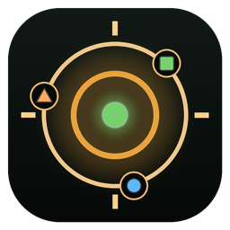
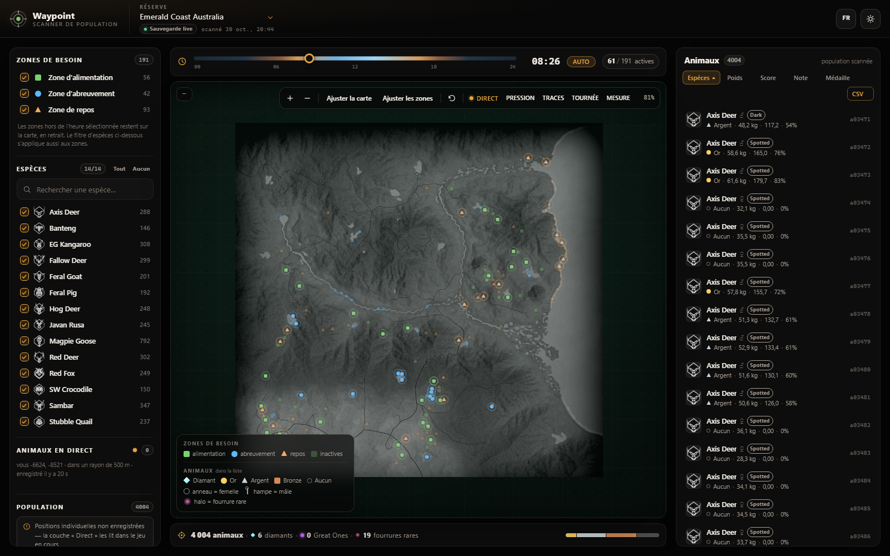

<p align="center"></p>

# Waypoint — COTW population & activity map

[](https://github.com/hakkitoudouble/waypoint/releases/latest)
[](LICENSE)
[](#download)

A clean-room replacement for the "Animal Population Scanner", rebuilt from the save
file format up, with a proper map overlay instead of a cramped fixed-size window.

It shows two things about a reserve in theHunter: Call of the Wild:

* **What is out there** — every animal in the population file: species, sex, weight,
  trophy score and predicted medal, colour-coded by rarity.
* **Where to go, and when** — every food / water / rest spot you have discovered,
  placed on the reserve map, filtered by the in-game hour and by species.



---

## Download

* **[Latest release](https://github.com/hakkitoudouble/waypoint/releases/latest)** — grab
  `Waypoint-<version>-win64.zip` (built by the workflow on each tag).
* **Nexus Mods** — the same archive on the mod page.

Unzip anywhere and run `Waypoint.exe`: the browser opens on
`http://127.0.0.1:8765`. No Python, nothing installed into the game, saves are opened
read-only. Keep the console window open — it is the local server. State (history,
recent spawns, radar cache) goes to `%LOCALAPPDATA%\Waypoint`, or wherever
`--data-dir` points.

Prefer to run from source? See [Running it](#running-it).

---

## Live animals: what the save gives, and what needs memory

`AnimalData_5` does have a `MapPosition {X, Y}` field, but the game always writes
`(0, 0)`. Across all 16 population files on the reference machine that is
**28 243 animals, not one non-zero coordinate**, and reading the population array out of
the running process confirms the same `(0, 0)` — the game keeps population records and
world entities in two separate structures.

Live positions therefore come from the **world entities in game memory**, read-only:

* a full scan for species hashes finds the entity records (~160 s, cached to
  `work/radar_entities.json`);
* each entity's position sits 580 bytes before its species hash, and it updates in
  place, so a refresh of all entities costs **under a millisecond**.

The offset is verified against observation, not guessed: with the player at
`(-7583.511, -13065.611)` the two Black Bears they could see at ~237 m and ~240 m came
out at 238.6 m and 239.1 m.

The player's own position is **not** read from memory — its X is findable but its Z is
not stored as a float32 matching the display. It comes from `playerinformation_adf`,
which holds `LastPlayerPositions`, the last saved position per reserve. The game rewrites
that file every few seconds to tens of seconds, so distances are as fresh as the last
autosave while the animal side stays live.

In the UI this is the **Live** toggle on the map toolbar and the live panel in the sidebar:
each animal is a coloured dot at its world position, with the nearest ones listed by
distance and a ring marking where you are. Tight clusters of the same species are real
groups of distinct individuals, not duplicate readings.

**The page follows the game.** The entities in memory belong to exactly one reserve — the
one the game has loaded — so `/api/radar` reports which reserve that is (`live_reserve`:
the saved player position whose median distance to the herd is smallest). Opened without
`?reserve=`, the page loads that reserve. Anchoring the same entities on another reserve's
saved position puts every animal past the 500 m simulation radius, the filter drops them
all, and the layer looks dead; that is exactly what happened when the page defaulted to
the highest reserve number. If you deliberately open another reserve anyway, the live
panel says where the game is and links straight to it.

## Tools on the map and in the panels

* **Route** — orders the zones that are active right now into a short tour from your
  position (nearest neighbour, then 2-opt), capped at ten stops, and numbers them on the
  map.
* **Measure** — click two points; the map draws the segment with its distance in metres
  and its bearing in degrees.
* **Nearby** (in the Alerts panel) — a banner when a live animal comes within 120 m, with
  a five-minute cooldown per animal so it does not nag.
* **CSV** (in the sort bar) — downloads the filtered list with species, gender, weight,
  score, trophy rating, medal, fur, seed, group and spawn area.
* **Changes** — the watcher's delta: which animals appeared and which disappeared since
  the previous scan. `id` is a placeholder in the save, so identity uses the
  `VisualVariationSeed`.
* **History** — one snapshot per reserve per day (total, diamonds, golds) kept by the
  server, so you can see a reserve drift over time.
* **Auto-refresh** — the watcher exposes a `data_version`; when it changes the page
  reloads the population in place, keeping your filters and the camera where they were.

## Alerts on diamonds and Great Ones

A watcher diffs the population files every 20 seconds. When the game spawns a new animal,
its record appears in the save; if that animal's trophy rating clears the diamond
threshold, or it belongs to the Great One record, the page shows a banner and adds a row
to the **Alerts** panel. A background tab also flashes its title.

Identity across snapshots is the `VisualVariationSeed`. The game writes `Id = 0` for every
animal, so the `id` in the contract is a synthetic placeholder; the seed is the only
per-animal value that is unique in practice (2078 distinct seeds for 2079 animals in the
largest reserve).

Two caveats worth knowing:

* **Only new spawns are reported.** A live animal's medal cannot be read from memory — an
  entity carries neither the score nor a link to its population record — so the alert is
  about the save, and its freshness is the save's.
* **The first scan is a baseline.** Existing animals never alert on startup, otherwise
  every diamond already in the reserve would fire at once.

The Great One rule is `species == "???"` (the placeholder record the vendor scanner keeps
for the six "Fabled" variants) or a fabled fur. No Great One exists in the saves on this
machine, so that half of the rule is verified against constructed records, not a real
spawn — `tools/verify_alerts.py` says so explicitly.

### New spawns, in green

The same diff answers a second question: *which animals are new?* The watcher keeps a
**rolling shortlist of the 5 most recent newcomers per reserve** — `spawns` in
`/api/alerts`, each record carrying the animal's `VisualVariationSeed` and the time it was
first seen — and the population list paints those rows **green**: a tinted row with a
green edge, a dot after the species name, and a count next to the list title
(`1 nouvel animal`, `5 nouveaux animaux`). Hovering a row gives its own spawn time.

The shortlist replaced an earlier "last scan cycle" rule, which a single new spawn used to
wipe: a quiet scan now changes nothing, a batch of ten keeps the five newest, and the same
animal seen twice is recorded once. It is written to `work/spawns.json`, so a server
restart does not erase it either — an animal stays green until five newer ones push it out.
Nothing is invented: the save has no spawn timestamp, so "new" always means "not in the
previous scan of that file".

## Map layers

Two optional layers sit under the need zones, both off by default:

* **Pressure** — the save carries `HuntingPressureMap`, a 256 × 256 grid of where hunting
  has pushed animals away. It is the same information the game paints as blue alert
  zones; this draws it for the whole reserve at once, projected with the recovered
  georeference. Reserve 9 has 318 active cells, peaking at 100.
* **Trails** — the live radar's positions, accumulated as you play. Nothing in the save
  records where animals actually walk, so this is data the app builds itself: every poll
  drops the observed animals into a 256 × 256 grid, kept per reserve in `localStorage`
  and flushed every 15 seconds. Over a session it becomes a heat map of real animal
  traffic rather than the theoretical need zones.

Clicking an animal in the **Live** panel flies the map to it.

## Planning panels

The sidebar also answers two questions the population data can support:

* **Active hours** — tick a single species and its zones are summarised as time windows
  per zone type, so you do not have to scrub the hour slider to find out when to go.
* **Where to hunt** — the same selection is compared across every populated reserve,
  sorted by diamonds then golds, from `/api/compare`.
* **Harvests** — the hunting log (species, fur, score, timestamp), which nothing else in
  the app surfaced.

## The in-game clock

The hour slider follows the game. `playerinformation_adf` carries a `TimeOfDay` field in
decimal hours, the radar already polls that file every 700 ms, so the slider is driven
straight from it and the need zones light up on their own as the day advances — no manual
scrubbing.

The **Auto / Manual** button next to the readout controls it: dragging the slider switches
to manual, and pressing the button goes back to following. The button turns amber when the
game has not written the file for over 30 seconds, so a stale clock is visible rather than
silently misleading.

## FursEvery animal's fur is **recomputed from its `VisualVariationSeed`**, not read: nothing in
the save records a fur (`FeatureModifiers` is 0 for all 28 243 animals), and a live entity
carries neither the seed nor a variant hash. The draw itself was recovered from the vendor
scanner's binary:

```
state = (seed * 0x343FD + 0x269EC3) mod 2^32     ; the MSVC rand() LCG
u     = ((state >> 16) & 0x7FFF) / 32768
roll  = trunc(u * totalWeight)
walk the species'/gender's entries accumulating weights;
the first entry whose cumulative weight exceeds roll wins
```

The per-species, per-gender weight tables come from the same binary (254 blocks of
`0x1F0` bytes at VA `0x1400CF170`) and are imported by `tools/import_fur_tables.py`.
103 species are covered per gender, 1665 variant entries in all.

The result is verified statistically by `tools/verify_furs.py`: all 28 244 animals get a
fur, and the observed variant frequencies match the table weights to within 1.9 sigma
over the largest samples — a wrong LCG constant or byte order would still give *a* fur to
every animal but would drift from the expected distribution.

The fur and its rarity (common → uncommon → rare → very rare → super rare → Great One)
appear as a coloured chip on every animal row, and the sidebar filters on them.

**On the map, per-animal fur is not available.** Map markers come from the live entities
in game memory, and those entities cannot be linked back to a save record: probing
+-2 KiB around an entity's species hash found neither the population seed nor the animal's
weight, and only 42 of the save's groups reference a need zone we can position (9–13 % of
animals). So the map shows species, and the list shows furs.

What the *save* persists, and what this map draws by default, is the **need zone** data:
every feed/drink/rest spot you have discovered, with a world position in metres, its
type, its active hours, and its species.

---

## Running it

Requires Python 3.10+ and numpy (the live layer's memory scan needs it); nothing else.

```powershell
cd cotw-pop
python waypoint.py            # starts the server AND opens the browser
# or, server only:
python -m cotw.server
```

Then open **http://127.0.0.1:8765** — it opens on the reserve the game is currently
running, and any other reserve can be picked from the reserve menu.

Options:

```
--port 8791          serve on another port (the next free one is used if busy)
--save-dir <path>    override the auto-detected save folder
--no-browser         do not open a browser window
--data-dir <path>    keep history / spawns / radar cache somewhere else
```

Saves are auto-detected at
`%USERPROFILE%\Documents\Avalanche Studios\COTW\Saves\<steamid>\`.

### Building the Windows release

```powershell
pip install pyinstaller numpy
python build.py            # -> dist/Waypoint/ and dist/Waypoint-<version>-win64.zip
```

That produces the portable package (exe + bundled web assets + `_internal`), copies
`README.md`, `INSTALL.txt`, `CHANGELOG.md` and `LICENSE` next to the executable, and
writes `dist/SHA256SUMS.txt`. The icon lives in `assets/waypoint.ico` (regenerate with
`python tools/make_icon.py`). The GitHub workflow in `.github/workflows/build.yml` runs
the same command on a tag and attaches the zip to the release.

The packaged app keeps its state in `%LOCALAPPDATA%\Waypoint` instead of the install
folder — see [cotw/paths.py](cotw/paths.py) — so an update never wipes the history or
the recent-spawns shortlist.

The page also works opened directly from `web/index.html` — it then falls back to a
bundled sample so you can look at the interface without any save file.

---

## What the interface gives you

| Control | What it does |
|---|---|
| Reserve picker | switches map and dataset |
| Hour slider | dims every need zone that is not active at that hour (wrap past midnight handled) |
| Species filter | prunes both the population list and the need-zone layer |
| Feed / drink / rest | zone type filter, with live counts of what is active right now |
| Medal filter | great one / diamond / gold / silver / bronze / none |
| Fur rarity | highlights rare fur variants |
| New spawns | rows tinted green, with a count next to the list title |
| Search + sortable list | find one animal among thousands and fly to it |

Zones whose species could not be determined are drawn hollow and dimmed rather than
hidden, so an unattributed hotspot never silently disappears.

---

## Language

The interface ships in **French** (the reference language of this build) and **English**
(the source of every key). The `FR` / `EN` button next to the theme toggle switches; the
choice is stored in `localStorage` and applied before the first paint, so there is no
flash of the other language.

```
web/i18n.js      the table (English keys, French values) plus t() / apply() / split()
web/index.html   the English source text, tagged with data-i18n* attributes
web/app.js       t("English source") wherever a label is built
```

* **The key is the English source string**: `t("Fit map")` → *Ajuster la carte*. A missing
  entry degrades to readable English instead of a raw identifier, and
  `tools/check_i18n.py` fails the build if a key is missing, unused, or loses a
  `{placeholder}` on the way.
* Static markup carries `data-i18n`, `data-i18n-title`, `data-i18n-aria-label`,
  `data-i18n-placeholder` and `data-i18n-content`; `i18n.apply()` rewrites those nodes in
  place. Everything built by `app.js` goes through `t()`.
* Switching language **reloads the page**. Every label is resolved once into constants at
  load time (`TYPE_LABEL`, `MEDAL_LABEL`, …) and the list/map pipeline is built on them, so
  a reload is the honest way to avoid a half-translated screen.
* Numbers and dates follow the language: `48,2 kg` and `scanné 30 oct., 20:44` in French,
  `48.2 kg` and `scanned 30 Oct, 20:44` in English.
* **Species and reserve names are not translated** — they are shown exactly as the save
  and `/api/reserves` spell them, because they come from the game files rather than from
  the interface.

To add a language: copy the `fr` block in `web/i18n.js`, translate the values, add the
code to `locales` and to `NAMES`, then extend `EXPECT` in `work/uiboot/boot.js`.
`tools/check_i18n.py` lists exactly which keys are still missing. See
[notes/i18n.md](notes/i18n.md).

---

## How it works

```
animal_population_<N>   "SAVE" container -> zlib -> ADF v4 document
                        -> Populations[] -> Groups[] -> Animals[]  (4004 in one reserve)
found_need_zones_adf    same container -> NeedZoneSave -> NZData[] -> zones
```

The ADF v4 grammar was recovered from the vendor binary and validated by exact
tiling: 68 save documents parse with zero residue. See
[notes/adf-v4.md](notes/adf-v4.md).

Species names come from a 135-entry `NameHashId` table recovered from the binary
(the hash function itself was never cracked, so the table is authoritative). Medal
thresholds come from the binary's per-species `(silver, gold, diamond)` triple,
cross-checked against community data for 117 species.

Two things were derived rather than read, and are labelled as such in the data:

* **Sex codes.** `1` and `2` occur; which is which was settled statistically —
  across every dimorphic species the code-1 animals are heavier (Red Deer 199.8 vs
  146.3 kg, Moose 511.8 vs 380.2 kg), so `1 = male`.
* **Need-zone species.** The game stores an opaque hash. It was resolved by
  constraint solving over reserve rosters: a type must belong to a species present in
  every reserve where that type appears, and types within a reserve are distinct.
  43 of 47 types resolved; the rest stay `null` rather than guessed.

---

## Verification

Every layer has a runnable check. All of them pass on real saves.

```
python tools/verify_all.py         # runs everything below and summarises
```

```
python tools/verify_save.py        # 16/16 save containers unwrap
python tools/verify_adf.py         # ADF v4 grammar, 10/10 over 68 documents
python tools/verify_pipeline.py    # 24+ assertions: species, sex, weights, medals, zones
python tools/verify_furs.py        # fur rolls match the recovered tables, 14 species groups
python tools/verify_thresholds.py  # medal cut-offs: 125 species, no structural gap
python tools/verify_alerts.py      # the diamond / great-one watcher fires once per animal
python tools/verify_delta.py       # appears / disappears, data_version, history cap
python tools/verify_endpoints.py   # every HTTP route, including hostile input (needs the server)
python tools/verify_radar_discovery.py  # continuous discovery, radius, phantom filter
python tools/check_ui.py           # DOM wiring: every element id, fixture globals, CSS hooks
python tools/check_i18n.py         # every label translated, no dead key, no untagged text
node work/uiboot/boot.js           # boots the real UI in jsdom, in French
COTW_LOCALE=en node work/uiboot/boot.js   # ... and in English
node work/uiboot/i18n.js           # i18n.js units: lookup, apply, persist, reload
```

`verify_pipeline.py` is the one that matters: it asserts the animal count, that the
roster matches the real reserve, that weights are physically plausible, that the
gender mapping is justified by dimorphism, that medals clear their species
threshold, that `MapPosition` is always zero, and that zone species are on the
reserve roster.

---

## Known limitations

* **Absolute map scale is inferred.** Reserves are not centred on the world origin
  (measured centroids sit in all four quadrants), so the plotting box is fitted per
  reserve from your own zones. If you have explored only half a reserve, its box is
  underestimated by roughly that much. See [notes/calibration.md](notes/calibration.md).
* **No bronze threshold exists** in any source, so "at least bronze" is modelled as
  "has a trophy score at all".
* **Great Ones** are not predicted: no per-species threshold is published.
* 4 need-zone types (all New England birds) remain unattributed.
* Need zones are a snapshot from your last save; they refresh when the game writes
  the file, not continuously.
* **Only French and English are translated**, and species / reserve names stay in the
  language of the game files. Switching language reloads the page (see
  [Language](#language)).

---

## Layout

```
cotw/            engine: save container, ADF parser, model, species, reserves, server
cotw/data/       recovered tables (species hashes, stats, medals, zone types, reserves)
web/             the UI: index.html, app.js, i18n.js, style.css, fixture.js, assets/
tools/           verification and reverse-engineering scripts
notes/           what was recovered and how, including dead ends
work/            scratch: disassembly harness, jsdom boot + i18n tests, screenshots
```

## Credits

The ADF container format was first documented publicly by **Rick Gibbed** for the
Just Cause series; his notes on the Avalanche engine were the starting point for
this work. Species and medal data cross-checked against The Wild Register and
TacMaps community references.

---

## License

The **code** is MIT — see [LICENSE](LICENSE).

The **game material** bundled with it (reserve maps, species icons, and the recovered
tables under `cotw/data/`) is derived from theHunter: Call of the Wild and remains the
property of Expansive Worlds / Avalanche Studios / THQ Nordic; it is included on the same
basis as any game mod and is not relicensed here. Details in [NOTICE.md](NOTICE.md).

Waypoint is not affiliated with, endorsed by, or supported by Expansive Worlds, Avalanche
Studios or THQ Nordic. It only reads save files the game has already written, and never
modifies them.
